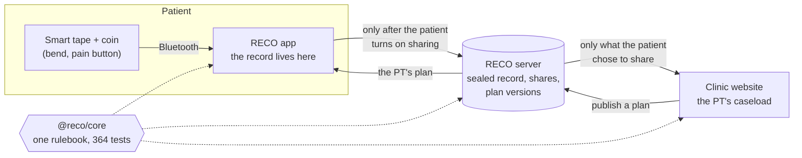

# How RECO works

_Version 1.0 · 2026-11-15 · For the team, and for the appendix of the pitch deck · Pairs with [backend.md](backend.md) (reference), [recovery-plan.md](recovery-plan.md), [protocol-path.md](protocol-path.md), [clinic.md](clinic.md)_

**Bottom line:** RECO is three pieces of software on one shared rulebook. The patient's phone holds their recovery record. A server keeps a sealed copy of that record only once the patient turns on sharing, and passes plans between a PT and their patient. A website shows each PT their patients' weeks. Every number on every screen is worked out from the record by the same tested code, so the phone and the PT's screen cannot disagree.

Everything below can be checked on a laptop in about ten minutes. [Section 8](#8-check-it-yourself) has the commands, and [section 9](#9-what-is-not-proven-yet) lists what is not proven yet.

## 1. The pieces

| Piece | Where it is | What it does |
|---|---|---|
| Rulebook, `@reco/core` | `kinn/app/packages/core` | Pure TypeScript. The record's types, every rule (status, flare-ups, patterns, protocol checkpoints, flags, plans), the exercise library, the tape protocol and what may be shared. No screens, no network. |
| Patient app | `kinn/app/apps/mobile` | Expo, iOS first. Logging, check-ins, the plan, the path, the report, the tape. Stores the record on the phone. |
| Server | `kinn/app/apps/api` | Node. Accounts, the sealed copy of a shared record, who shares with whom, every published plan version. Stores facts and works nothing out. |
| Clinic website | `kinn/app/apps/clinic` | The PT's caseload: each patient's week, progress, next steps, flags, and the plan editor. |
| Marketing site | `kinn/site` | The public homepage and waitlist. Separate code, separate deploy, untouched by any of this. |

**The one rule:** store facts, derive everything else. A check-in, a pain press, a measurement and a plan a PT wrote are facts. Today's status, a flare-up, the protocol phase, a flag on the PT's screen and RECO's own plan are derived each time from the facts. Nothing derived is ever saved, so changing a rule changes it everywhere at once.

## 2. A day, step by step

1. **Morning check-in.** The patient answers two things: pain 0 to 10, and swelling (none, some, a lot). The app saves one record: `{ date, pain, swelling }`.
2. **Today's read.** The app runs `deriveToday(record, today)`. First rule that matches wins: morning pain 5 or more, a lot of swelling, or last night's pain that did not settle is a flare-up morning. Pain 3 or more, some swelling, or yesterday's load above 1.3 times the 7-day usual holds the day steady. Otherwise the day is clear.
3. **During the day.** One tap on the pain button saves the time before any question is asked. Detail is optional. Activities are logged in two taps. With the tape on, a bend past the limit in force for 0.3 seconds is saved as a bend alert, once per bend.
4. **Next morning.** "Did it settle?" is asked for last night's pain. The answer is the strongest flare-up signal RECO has.
5. **Patterns.** Once there are two flare-ups, the app counts what came before them: "3 of your last 4 flare-ups came after game days." It reports what came before, never what caused it.
6. **Where they are in recovery.** For ACL reconstruction and meniscus repair, the phase comes from published checkpoints (section 4), not from the calendar.
7. **If sharing is on,** a few seconds after any change the phone sends the record to the server (section 5). If it is off, nothing leaves the phone.

## 3. The PT's side, step by step

1. **The PT signs in** on the clinic website with their work email and an 8-digit code. There is no password to keep or lose. PT accounts are by invitation during the pilot.
2. **The PT makes a sharing code** (8 characters, works once, lasts 7 days) and gives it to the patient.
3. **The patient types the code** into the app (Settings, then Share with my PT). The app shows the PT's name and email, lists what is always shared and what is optional, and the patient taps Share. Nothing is shared before that tap.
4. **The patient appears on the PT's patients table,** with a small recovery progress bar and a word tag for anything that needs attention. Their chart has three tabs: Summary, Daily log and Exercise plan.
5. **Flags** put the patients who need attention at the top. Contact soon: pain 8 or above, a note with red-flag words, or the knee giving way. Worth a look: flare-up mornings, bends past the limit. Note: a stalled checkpoint, or past the phase's typical window. Flags are about the knee, never about whether exercises were done.
6. **The PT writes a plan:** picks from the library or types their own exercises, edits doses, and chooses whether RECO may swap in a lighter dose on flare-up mornings. Publishing makes version 1, then 2, and so on. A version is never edited.
7. **The plan reaches the phone** the next time the app opens. The patient sees "From Dana Ruiz, PT · version 2".
8. **The patient can see every time the PT looked,** change what is shared, or stop sharing. Stopping cuts the PT off at once.

## 4. The model

"Model" here means two things: the rules that turn a record into guidance, and the data the server stores. There is no machine-learning model anywhere in RECO today. Every output is a fixed, readable rule with a named constant, which is what lets us test it and explain it.

### 4.1 Which phase someone is in

The protocols are data, taken from Mass General Brigham's criterion-based protocols (ACL reconstruction 2024, meniscus repair 2021) and cross-checked against the MOON guidelines: 6 phases each, 26 checkpoints for ACL and 24 for meniscus repair. Code: `core/src/protocol/`.

A person leaves a phase only when both are true:

1. every required checkpoint of the phase is met, and
2. the next phase's healing-time floor has passed.

Meeting checkpoints early never skips the floor. Passing the floor never skips the checkpoints. A finished phase stays finished: a bad week later shows as a checkpoint slipping, not as going back a phase.

| Checkpoint | Who measures it |
|---|---|
| Bend, straightening, the gap to the other knee | The tape, or a measurement typed in and labelled by who took it |
| Swelling | The morning check-in (optionally a guided stroke test) |
| Pain or swelling after exercise | A pain log that did not settle in the last 7 days |
| Straight-leg raise, single-leg squats, joint-position test | A one-minute self-test |
| Strength ratios, hop tests, sign-off | The PT only, entered from the clinic or the "From my PT" sheet |

"Equal to the other knee" means within 3° of bend and 2° of straightening, because goniometers differ by a few degrees between clinicians. A projection ("at your current pace") fits a line to the last 14 days, needs at least 5 readings, calls under 0.2° a day "levelled off", and is always shown as a range of ±35%, never a date. RECO shows which published checkpoint someone has met. It never clears anyone; the last phase says the surgeon and PT make that call.

### 4.2 Which plan someone follows

`resolvePlan` decides, in this order, and both apps call it:

1. **The plan their PT published** on the clinic website.
2. **A plan they typed in** from their PT's sheet.
3. **RECO's own plan, at the Guided level only.** It is derived each day from the protocol phase and the day's read, drawn from a small conservative set of 18 knee exercises: a steady day gets the lighter dose, a flare-up morning becomes a recovery day, and two flare-ups in ten days hold the plan back one phase. It is off until a regulatory review; the app launches at the Descriptive and PT-led levels.
4. **Otherwise no plan.** The patient sees their phase in plain words and how to find a PT.

A plan a person wrote is a stored, versioned fact. RECO's plan is derived and never stored. RECO changes a PT's plan in exactly one way, and only if the PT turned it on per plan: on a flare-up morning it shows the lighter dose the PT set.

### 4.3 The exercise library

85 knee exercises a PT can pick from, each with a starting dose, a lighter dose, how to do it, the plan phase it belongs to, and the protocol checkpoints it works toward on that patient's own protocol. Code: `core/src/plan/pt-library.ts` and `library.ts`.

| By plan phase | | By kind | |
|---|---|---|---|
| 1 · Protect and move | 20 | Range of motion | 9 |
| 2 · Build strength | 23 | Quad activation | 5 |
| 3 · Build capacity | 23 | Leg strength | 22 |
| 4 · Back to your activity | 19 | Hip and core | 13 |
| | | Balance and control | 5 |
| | | Walking and cardio | 10 |
| | | Jumping and landing | 10 |
| | | Running and agility | 11 |

71 of the 85 name at least one checkpoint they work toward. 10 carry a "check first" note from the protocols (for example, resisted hamstring work after a hamstring graft). The six protocol phases map onto the four plan phases through one explicit table: 1 and 2 to 1, 3 to 2, 4 to 3, 5 and 6 to 4.

The list comes from the exercises the published protocols name. **It has not been reviewed by a PT yet.** That review is the first thing to ask a design-partner PT for.

### 4.4 What the tape adds

The tape's capacitive sensor tracks bend. Two calibration points, the leg straight (0°) and a bend the person enters (ideally measured by their PT), give degrees on a straight line between and beyond them. The app checks every reading (20 a second) against the bend limit in force and saves a bend alert once the knee stays past it for 0.3 seconds; the knee has to come back 3° under the limit before another counts. **The straight-line assumption has not been checked against a goniometer.** Every tape number on screen today is sample data or a prototype reading.

## 5. The server

Code: `kinn/app/apps/api`. Reference: [backend.md](backend.md) sections 6 to 9.

### 5.1 What it stores

Nine tables. All are facts; there is no table of statuses, flags or scores.

| Table | Holds | Notes |
|---|---|---|
| `accounts` | email, role (patient or PT), name | One email is one kind of account |
| `login_codes` | a keyed hash of each sign-in code, its expiry, wrong guesses | 10 minutes, one use, dead after 5 wrong guesses |
| `sessions` | the SHA-256 of each session token, its expiry | 30 days on a phone, 12 hours on the clinic site |
| `datasets` | the patient's record as one sealed document, and a revision number | Sealed with AES-256-GCM |
| `invites` | a keyed hash of each PT sharing code | Works once, 7 days |
| `shares` | patient, PT, what is shared, when it was turned on and off | The patient's choice; at most one live share per pair |
| `plans` | every published plan version, sealed | Never edited; the highest version is in use |
| `access_log` | each time a PT opened a record or published a plan | The patient can read it |
| `rate_limits` | counters | Limits guessing and floods |

### 5.2 What a PT can and cannot see

The server cuts the record down before it leaves, with one function, `scopedDataset`, so a part that is not shared never reaches the clinic website at all.

| | |
|---|---|
| **Always, with any share** | Name, sport and goal, injury and dates, each morning's check-in (pain and swelling), where they are on the protocol, a plan they typed in |
| **The patient's choice** | Range and checkpoints (measurements, self-tests and checkpoint answers) · Pain logs · Activity · Tape alerts · Notes in their own words (off by default) |
| **Never** | Which exercises were ticked off, voice notes, photos, "that was wrong" taps on warnings |

Exercise check-offs are left out on purpose. An early interviewee rejected compliance tracking as "a policing device", and the vision says the record belongs to the patient.

### 5.3 What protects it

1. **No passwords.** Sign-in is an emailed 8-digit code that works once, for 10 minutes, and dies after 5 wrong guesses; guesses are also capped per email. Only a keyed hash is stored, so a copy of the database cannot be used to sign in.
2. **Sealed at rest.** Records and plans are encrypted with a key that lives in the server's environment, never in the database. Each sealed record is bound to its patient's row, so it cannot be moved to another patient.
3. **Sharing is the patient's.** A PT's code only names the PT. The patient sees who it is and agrees, picks what is shared, and can stop at any time.
4. **Every PT read is logged** where the patient can see it.
5. **Nothing is trusted on the way in.** Every request is checked against a strict schema; a field the server does not know is refused. A plan also passes `validatePlan`, the same check the editor runs, so a valid draft is never refused and an invalid one never stored.
6. **Limits.** Codes per email and per address, guesses per code, sharing-code tries per patient, requests per address.
7. **Delete my data** removes the account and everything under it in one step, on the server and on the phone.
8. **Production is the default.** A host that sets nothing gets the strict rules, and the server refuses to start with any secret missing. The relaxed laptop mode has to be asked for by name.

An independent security review of the server was run on 2026-11-15. It found no way for a PT to reach an unshared patient, for one patient to reach another, or to inject SQL, and no misuse of the encryption. It raised ten points; the six that mattered are fixed and tested (the laptop mode could be reached by accident on a host, the caller's address could be forged behind a proxy, sign-in codes were too guessable, reading plan history was not logged, one damaged record hid a whole caseload, and the share screen did not spell out everything that is always shared). The four left open are in section 9.

### 5.4 The routes

20 in all. Every answer has the same shape: `{ success, data }` or `{ success, error, code }`.

| For | Route | Does |
|---|---|---|
| Anyone | `POST /v1/auth/start`, `/v1/auth/verify` | Email a code; trade it for a session |
| Signed in | `GET, PATCH, DELETE /v1/me`, `POST /v1/auth/logout` | Who am I, rename, delete everything, sign out |
| Patient | `GET, PUT /v1/me/dataset` | Read and save the record (a stale copy is refused) |
| Patient | `GET, POST /v1/me/shares`, `POST /v1/me/shares/preview`, `PATCH, DELETE /v1/me/shares/:id` | See, start, change and stop sharing |
| Patient | `GET /v1/me/plan`, `GET /v1/me/access-log` | The PT's latest plan; who looked |
| PT | `POST /v1/invites` | Make a sharing code |
| PT | `GET /v1/patients` | The caseload, each record cut to what was shared |
| PT | `GET, POST /v1/patients/:id/plans` | Plan history; publish the next version |
| Host | `GET /healthz` | Is it up, and on which database |

## 6. One example, start to finish

Leo is seven weeks out from ACL reconstruction. This is the sample patient the tests and the demo use.

1. Thursday: Leo logs gym, then presses the pain button at 21:00, rating 6.
2. Friday morning: check-in pain 5. Rule: pain 5 or more is a flare-up morning. "Did it settle?" No.
3. It happens again Saturday. Two flare-ups in three days.
4. On Dana's caseload, Leo moves up with an amber "Worth a look · 2 flare-ups in 3 days". His daily log marks those mornings with an amber "Flare-up" tag, the same amber as the flag.
5. Dana opens Leo's plan. The library opens on his phase and shows that mini squats work toward "Quad strength ≥80% of other leg", an open checkpoint for him. She adds three exercises, turns on "swap in a lighter dose", and publishes version 1.
6. Leo opens RECO. His plan reads "From Dana Ruiz, PT · version 1". On his next flare-up morning the squats show 2 × 10 instead of 3 × 12, marked as lighter.
7. Under "Who looked", Leo sees: Dana Ruiz, PT opened your record; Dana Ruiz, PT sent you a plan.

Steps 4 to 7 were run on a laptop through the real website, server and app code on 2026-11-15 (the app in its browser build).

## 7. For the appendix slide

**How RECO works**

- The patient's phone holds their recovery record. A sealed copy reaches our server only when they turn on sharing with a PT they name.
- One tested rulebook turns the record into everything on screen, for the patient and the PT alike. No black box: every output is a readable rule.
- Recovery phase follows published, criterion-based protocols (Mass General Brigham ACL and meniscus repair): checkpoints met and healing time passed, never the calendar alone.
- PTs write plans from a library of 85 knee exercises, each tied to the checkpoints it works toward. Plans are versioned and reach the phone.
- The patient chooses what the PT sees, sees every time they looked, and can stop any time. Exercise check-offs are never shared.

| 468 | 50 | 85 | 20 |
|---|---|---|---|
| automated tests passing | published checkpoints modelled | knee exercises in the library | server routes, each tested |

Say out loud if asked: it runs end to end on our laptops today. It is not yet live for real patients, the exercise and protocol content has not had its PT review, and the tape's degrees have not been checked against a goniometer.

## 8. Check it yourself

From `kinn/app`, with Node 20 or newer. The first command installs everything.

| Claim | How to check | What you should see |
|---|---|---|
| The rules are tested | `npm ci` then `npm test` | 364 core, 39 clinic and 65 server tests pass |
| It typechecks | `npm run typecheck` | No output after each package name |
| The server's database is real Postgres | `npm run test -w reco-api` | `postgres.test.ts` passes: it drives the server through the production Postgres driver |
| A PT cannot see an unshared patient | `apps/api/test/sharing.test.ts`, "one PT never sees another PT's patient" and "stopping the share cuts the PT off at once" | Both pass |
| Records are sealed in the database | same file, "it is sealed in the database" | The stored row contains none of the record's text |
| Unshared parts never leave the server | `packages/core/test/sync/scope.test.ts` | All 32 combinations of scopes pass |
| The library is what we say | `packages/core/test/plan/pt-library.test.ts` | 85 exercises, unique ids, every dose readable |
| The whole loop, by hand | Three terminals: `npm run api`, then `npm run seed:local -w reco-api`, then `VITE_API_URL=http://localhost:8787 npm run clinic`. Open http://localhost:5174 and sign in as `dana@clinic.example`; the code is shown on the page. | Four patients, one still "waiting for their phone". Write and publish a plan. |
| The patient's side of the loop | `cd apps/mobile && EXPO_PUBLIC_API_URL=http://localhost:8787 EXPO_PUBLIC_WEB_REAL=1 npx expo start`, press `w`, finish onboarding, then Settings → Share with my PT | Sign in, type a code made on the clinic site, and the plan you publish there appears under Plan |

## 9. What is not proven yet

Ordered by how much each one matters before a real patient uses it.

1. **Not live.** The server runs on a laptop and in tests. Going live needs a Postgres database, five secrets and a host ([apps/api/README.md](../app/apps/api/README.md)). The Vercel build is generated but has not been run on Vercel.
2. **Not on a real phone yet.** The patient's sharing screen was run through the app's browser build. It needs a new native build (it adds the Keychain module) and a run on an iPhone.
3. **Privacy policy and consent text.** Both say data stays on the phone. That stays true until sharing is turned on, and the share screen says what changes, but the policy itself must be updated before the feature ships.
4. **Health-data law.** No HIPAA assessment has been done. If a clinic uses the website, RECO likely needs business associate terms with the clinic and with its hosts. The regulatory hour in the pilot spec covers this and the Guided plan.
5. **Clinical content is unreviewed.** The protocol checkpoints and the 85 exercises come from published sources and have not been checked by a PT.
6. **The tape's degrees** assume a straight line between two calibration points. Unchecked against a goniometer.
7. **Sign-in email.** The code that calls the email service is written and the flow around it is tested with a stand-in mailer; a real email has not been sent.
8. **One phone per person.** A second phone would overwrite the first. Merging two phones' records is not built.
9. **Left open from the security review.** Someone who knows a person's email can use up that email's sign-in codes for 15 minutes at a time, which delays their sign-in but gives no access. Changing the encryption key means re-sealing every record, and that step is not built. The clinic site keeps its session in the browser tab, so it needs a content security policy before real use. A PT email that is not on the invitation list is told so.
10. **PT accounts** are an allowlist of emails. There are no clinics, teams or admin screens.
11. **Every patient shown anywhere today is a sample.** Nothing in the deck should present sample numbers as measurements.
