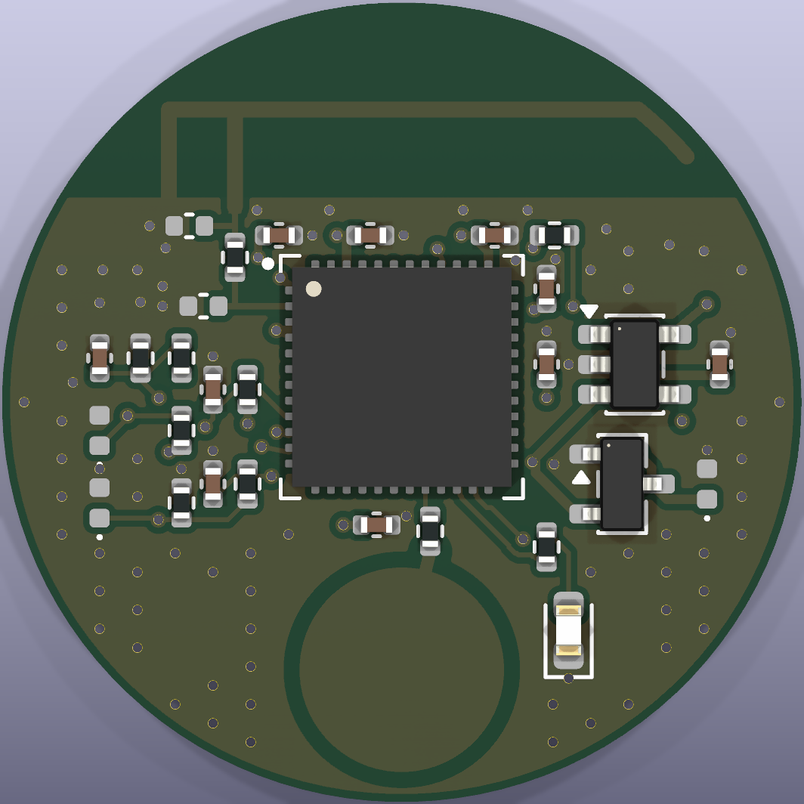
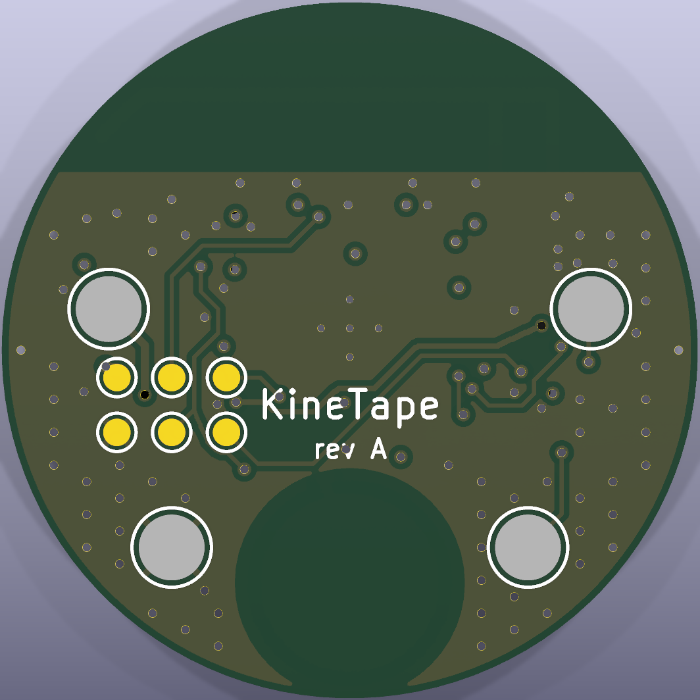

# KineTape puck — PCB (rev A)

A 25.4 mm (1 in) round, 4-layer board that snaps onto the tape: ESP32 + printed BLE antenna,
capacitive touch button, status LED, and four spring contacts on the bottom that reach the battery
and pressure sensor built into the tape.

| | |
|---|---|
|  |  |

**Status:** schematic ERC-clean; board fully routed, **0 DRC violations / 0 unconnected / 0 schematic-parity
errors** (KiCad 10.0.7, all severities). **Not yet fabricated or RF-tested** — see [Before you order](#before-you-order).

## What's on it

| Block | Parts | Notes |
|---|---|---|
| MCU | U1 ESP32-PICO-V3-02 (LGA-48, 7×7 mm) | Classic ESP32 + 8 MB flash + 2 MB PSRAM + crystal in one package, so the existing `esp32dev` firmware runs. |
| Antenna | AE1 printed inverted-F, R10 + C11/C12 pi network | IFA runs along the top edge (above the ground cut). C11/C12 are **DNP** until tuned. |
| Power | Q1 AO3401A, U2 ME6211 3.3 V LDO, C1/C3 | Battery comes from the tape (J1). Q1 = reverse-polarity protection. ME6211: 500 mA, VIN up to 6 V. |
| Battery sense | R1/R2 1 MΩ divider + C4 → GPIO35 | VBAT/2, ~2 µA drain. |
| Sensor | J3/J4 + R7, R8, R9, C10 | Same divider as the firmware README: 3V3 → sensor → GPIO34 with 10 kΩ to GND (+1 kΩ/100 nF RC filter). |
| Touch | TS1 Ø6.5 mm electrode, R6 470 Ω | Electrode on the top layer under solder mask; no copper under it on inner/bottom layers. |
| LED | LED1 green 0603, R5 470 Ω → GPIO2 | Same pin as the firmware. |
| ESD | D1–D3 (0402) on every tape contact | The contacts touch the tape and skin. |

### Tape contacts (bottom side, Harwin P70-1000045R SMT spring pins)

| Contact | Net | Position (from centre, top view) |
|---|---|---|
| J1 | VBAT in (3.0–5.5 V) | (+8.8, +1.5) mm |
| J2 | GND | (+6.5, −7.2) mm |
| J3 | SENS_A (3.3 V via 100 Ω) | (−8.8, +1.5) mm |
| J4 | SENS_B (→ ADC) | (−6.5, −7.2) mm |

The pattern is deliberately asymmetric, so the puck can only mate one way. The tape needs four flat
conductive pads (snaps, conductive fabric or foil) at these positions. Spring free height is 3.5 mm,
working height 2.9 mm.

### GPIO map (firmware)

| GPIO | Function | vs current firmware |
|---|---|---|
| 34 | Sensor ADC (ADC1_CH6) | unchanged |
| 2 | Status LED | unchanged |
| 35 | Battery sense, VBAT/2 (ADC1_CH7) | new; matches the "Future" note in `firmware/README.md` |
| 13 | Touch button (`T4`, `touchRead(13)`) | new |
| 1 / 3 | UART0 TX / RX (programming pads) | unchanged |
| 0 / EN | Boot / reset (programming pads) | — |

### Programming

The 2×3 pad grid on the bottom (Ø1.0 mm, 2.0 mm pitch) is for a pogo-pin jig plus a 3.3 V USB-UART adapter:

```
TP3 TXD  (4.5,-1.0)   TP4 RXD (6.5,-1.0)   TP1 3V3 (8.5,-1.0)
TP5 EN   (4.5,-3.0)   TP6 IO0 (6.5,-3.0)   TP2 GND (8.5,-3.0)
```

There is no auto-reset circuit. To enter the bootloader, hold IO0 to GND and pulse EN to GND, then flash
with `pio run -t upload`. To power the board for flashing, feed VBAT through J1. Back-feeding TP1 (3V3)
works but pushes current into the LDO output.

## Board

- 25.4 mm circle, **4 layers, 1.0 mm** FR-4. F.Cu signals + GND pour; In1 = solid GND plane;
  In2 = +3V3 plane; B.Cu signals + GND pour.
- Rules: 0.15 mm track/space (power 0.25–0.3 mm), vias 0.5/0.3 mm (thermal-pad vias 0.5/0.25 mm),
  all within JLCPCB's standard 4-layer capability.
- RF feed: 0.2 mm trace, pre-routed and locked; ground stitching along the antenna ground edge.
- No copper on any layer above the ground edge (antenna keepout), and none under the touch electrode on the
  inner and bottom layers.

## Before you order

These are the things I could not verify from here. Each one should be checked rather than assumed.

1. **The antenna is untuned and uncertified.** The IFA (19.9 mm arm + stub) is deliberately a bit long,
   so it should resonate low. Plan on a VNA (a NanoVNA is enough): measure S11 at R10, trim the open end
   of the arm, and fit C11/C12 to match 50 Ω. The enclosure and skin will detune it further, so tune it
   inside the enclosure, on an arm. Without tuning, BLE will probably still work at a few metres, but range
   is unknown. A bare chip with your own antenna also means the radio is uncertified (FCC/CE), which is fine
   for a prototype but not for selling it.
2. **ESP32 land pattern.** The LGA-48 footprint is built from Espressif's datasheet (v1.4, Fig. 16:
   0.25 × 0.68 mm lands, 6.73 mm between opposite land centres, 4.5 mm thermal pad with a 4.0 mm
   mask opening). Compare it against Espressif's land-pattern source file before ordering.
3. **Spring-contact pad.** Ø2.4 mm pad for the Ø2.0 mm Harwin P70-1000045R body. Check it against
   Harwin's drawing.
4. **JLCPCB part numbers.** Check stock and Basic/Extended status in the BOM upload. The ESP32
   (C908392), ESD diodes and springs are Extended parts, so each adds a loading fee.
5. **Rotations.** In JLCPCB's placement preview, check pin 1 of U1, the orientation of U2/Q1, and LED1
   polarity.
6. **Double-sided assembly.** J1–J4 are on the bottom. Either pay for both sides, or assemble the top
   only and hand-solder the four springs.
7. **Battery and power budget.** BLE on a classic ESP32 averages roughly 40–100 mA, with peaks around
   130–250 mA. The battery in the tape has to deliver those peaks through the contacts, so contact
   resistance matters. Firmware sleep (see the power notes in `firmware/README.md`) decides battery life
   far more than this board does.

## Regenerating

Everything is generated from [`scripts/design.py`](scripts/design.py) (parts, nets, placement).
Don't hand-edit the `.kicad_*` files and then rerun the scripts, because the scripts overwrite them.
Run with KiCad's Python from `hardware/`:

```bash
"C:/Program Files/KiCad/10.0/bin/python.exe" scripts/build.py    # footprints, schematic, placed board, fanout
"C:/Program Files/KiCad/10.0/bin/python.exe" scripts/route.py    # Freerouting + finishing router + stitching
"C:/Program Files/KiCad/10.0/bin/python.exe" scripts/export.py   # DRC gate, then fab/ outputs
```

`route.py` needs `tools/freerouting.jar` (Freerouting 1.9.0, Java 17; git-ignored). It briefly opens a
Freerouting window. Whatever Freerouting leaves unrouted, the grid router in `scripts/finish.py`
completes. `export.py` refuses to write outputs unless DRC and schematic parity are clean.

| Script | Does |
|---|---|
| `design.py` | The circuit: every part, its LCSC number, pin → net, PCB position |
| `footprints.py` | Custom footprints: ESP32-PICO LGA-48, IFA antenna, touch pad, spring contact |
| `schematic.py` | Writes the `.kicad_sch` (net labels on every pin); KiCad's own netlist export is then checked against `design.py` |
| `build.py` | Board outline, placement, pours, keepouts, locked RF route, power fanout and escape vias |
| `fanout.py` / `finish.py` | Clearance-checked via fanout; grid A* router for leftovers |
| `export.py` | Gerbers + drill zip, JLCPCB BOM/CPL, schematic PDF, STEP |

## Ordering (JLCPCB)

1. Upload `fab/kinetape_puck_gerbers.zip`. Set 4 layers, 1.0 mm, ENIG (recommended for the LGA and the
   spring contacts), and the default impedance-free stackup.
2. PCB Assembly: upload `fab/kinetape_puck_bom.csv` and `fab/kinetape_puck_cpl.csv`, then check the
   placement preview (see item 5 above).
3. Optional: use `fab/kinetape_puck.step` to design the enclosure. It has the antenna at the top edge,
   and the touch electrode should sit under a thin (≤ 1.5 mm) plastic lid.
